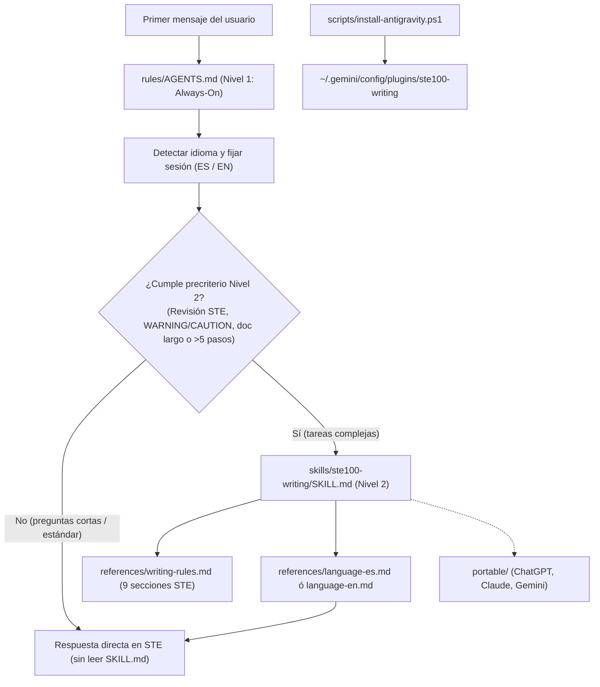

# Mapa de Estructura de ste100-writing

Este documento describe la arquitectura en dos niveles del proyecto y cómo interactúan sus componentes.



## Árbol de Directorios

```text
d:\Skill\ASD-STE100\
├── README.md                           # Documentación principal en inglés
├── README.es.md                        # Documentación principal en español
├── LICENSE                             # Licencia MIT y avisos de copyright
├── CHANGELOG.md                        # Registro histórico de versiones
├── .gitignore                          # Exclusión de archivos fuente propietarios
├── docs/
│   ├── MAP.md                         # Este documento de arquitectura
│   ├── ROADMAP.md                     # Plan de evolución de versiones
│   └── VERSIONING.md                  # Especificación de control de versiones
├── plugin/
│   └── ste100-writing/
│       ├── plugin.json                # Manifiesto de plugin de Antigravity
│       ├── rules/
│       │   └── AGENTS.md              # Regla Always-On (Nivel 1 y precriterio)
│       └── skills/
│           └── ste100-writing/
│               ├── SKILL.md           # Maestro de instrucciones (Nivel 2 bajo demanda)
│               ├── references/
│               │   ├── writing-rules.md # 53 reglas de Issue 9 parafraseadas
│               │   ├── language-en.md   # Adaptación y restricciones para inglés
│               │   └── language-es.md   # Adaptación para español (usted / infinitivo)
│               └── examples/
│                   ├── before-after-en.md # Casos prácticos en inglés
│                   └── before-after-es.md # Casos prácticos en español
├── portable/
│   ├── system-prompt.md               # Prompt general para Claude Projects o Gemini Gems
│   ├── chatgpt-custom-instructions.md # Formato compacto para Custom Instructions
│   └── README.md                      # Instrucciones paso a paso de uso externo
├── scripts/
│   ├── install-antigravity.ps1        # Script de instalación global en Antigravity
│   └── uninstall-antigravity.ps1      # Script de desinstalación
└── source/                            # Carpeta local privada con PDFs de referencia
```
